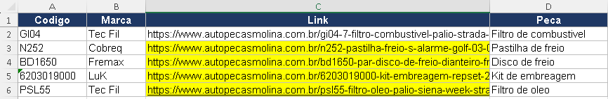
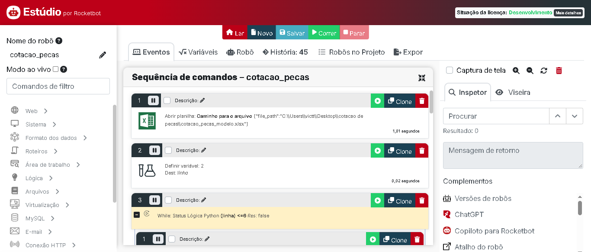
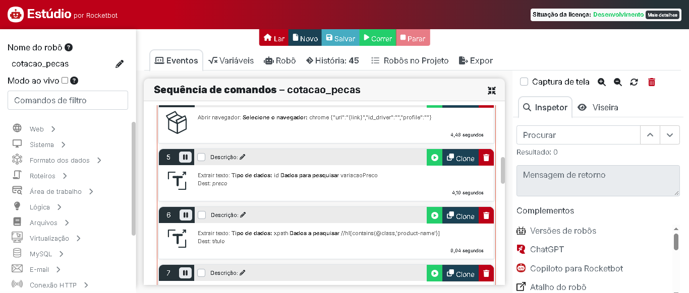
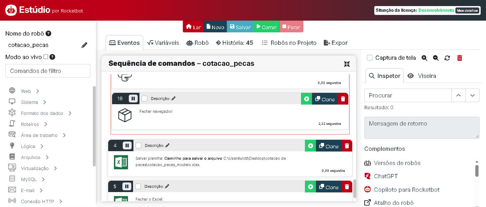
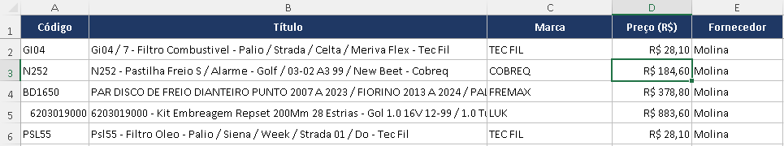

# 🤖 Robô de Cotação de Peças (RPA)

Projeto de automação desenvolvido no **Rocketbot Studio** para consultar preços de autopeças no site da **Auto Peças Molina** e registrar automaticamente as informações em uma planilha Excel, facilitando o trabalho manual e repetitivo.

**Autor:** Victor Hugo

---

## 📌 O problema

Em uma loja de autopeças, consultar preços de vários produtos em sites de fornecedores é um trabalho manual e repetitivo: abrir o site, procurar a peça, copiar título, marca e preço, inserir na planilha e repetir o processo para cada item.

## ⚙️ O que o robô faz

1. Abre a planilha e acessa a aba **lista**.
2. Lê o código e o link de uma peça.
3. Abre o link no Google Chrome.
4. Captura o título, o preço e a marca do produto.
5. Trata o texto da marca, removendo o prefixo "MARCA:".
6. Acessa a aba **Cotacao** e registra código, título, marca, preço e fornecedor.
7. Fecha o navegador e passa para a próxima peça.
8. Repete o processo até finalizar a lista e salva a planilha.

## 📂 Arquivos do projeto

| Arquivo | Descrição |
|---|---|
| `cotacao_pecas.json` | Robô exportado do Rocketbot Studio |
| `cotacao_pecas_modelo.xlsx` | Planilha modelo com as abas lista e Cotacao |
| `lista_pecas.xlsx` | Lista de peças para consulta |
| `01_aba_lista.png` | Print da planilha de entrada |
| `02_robo_inicio.png` | Início do robô e laço While |
| `03_robo_leitura.png` | Leitura dos dados da página |
| `04_robo_fim_do_laco.png` | Finalização do laço |
| `05_resultado_cotacao.png` | Resultado das cotações |

## 📊 A planilha

### Aba lista — Entrada de dados

Cada linha contém as informações de uma peça.

| Código | Marca | Link | Peça |
|---|---|---|---|
| GI04 | Tec Fil | Link da página do produto | Filtro de combustível |

O robô utiliza as colunas **Codigo** e **Link**. As colunas Marca e Peça servem para conferência.

### Aba Cotacao — Resultado

O robô registra os seguintes campos:

- Código
- Título
- Marca
- Preço (R$)
- Fornecedor

## 🖼️ Demonstração do projeto

### 1. Planilha de entrada — Aba lista

Cada linha contém o código da peça, a marca e o link do produto.

### 2. Robô desenvolvido no Rocketbot Studio

Início do robô: abre a planilha, define a linha inicial e inicia o laço While.

### 3. Leitura dos dados da página

Dentro do laço, o robô acessa o link do produto e captura o preço, título e marca.

### 4. Finalização do processo

O robô fecha o navegador e, após percorrer todas as peças, salva a planilha e fecha o Excel.

### 5. Resultado das cotações

Exemplo dos dados registrados na aba Cotacao.

## 💰 Exemplo de resultado

Cotação realizada em 22/11/2026.

| Código | Marca | Preço |
|---|---|---:|
| GI04 | TEC FIL | R$ 28,10 |
| N252 | COBREQ | R$ 184,60 |
| BD1650 | FREMAX | R$ 378,80 |
| 6203019000 | LUK | R$ 883,60 |
| PSL55 | TEC FIL | R$ 28,10 |

## 🚀 Como utilizar

1. Instale o Rocketbot Studio.
2. Importe o arquivo `cotacao_pecas.json`.
3. Preencha a aba **lista** com os códigos e links das peças.
4. No comando **Open Workbook**, ajuste o caminho da planilha no seu computador.
5. Se a quantidade de peças mudar, ajuste a condição do While. Atualmente, está configurada como `{linha} <= 6`.
6. Feche o Excel.
7. Execute o robô utilizando o botão **Run**.

## 📚 O que aprendi com este projeto

- Captura de informações de páginas web utilizando ID, classe e XPath.
- Utilização de variáveis e contadores.
- Criação de estruturas de repetição com While.
- Tratamento de textos utilizando comandos Python.
- Leitura e escrita de dados em diferentes abas do Excel.
- Conversão de preços de texto para números utilizando `=VALUE(...)`.

## 🔧 Limitações e próximos passos

- Atualmente, os links dos produtos são inseridos manualmente.
- O robô consulta apenas um fornecedor: Auto Peças Molina.
- Futuramente, pretendo implementar a busca automática de peças pelo código.
- Adicionar outros fornecedores para comparar preços.
- Desenvolver uma funcionalidade para leitura de notas fiscais XML e entrada automática de produtos.

---

**Projeto desenvolvido para fins de estudo e prática de automação RPA utilizando Rocketbot Studio.**
